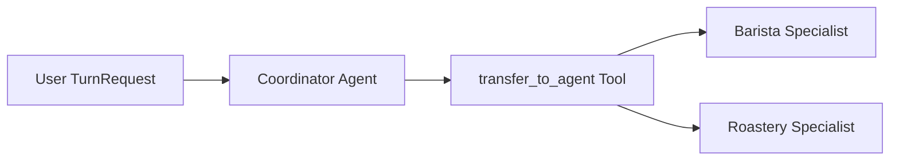

# Agent Groups & Handoffs

When a domain problem spans multiple areas of expertise, `AgentGroup` (`litestar_mcp.agent.AgentGroup`) coordinates a primary triage or routing `Agent` (`coordinator`) and one or more domain-focused `Agent` instances (`specialists`) within a single `AgentRuntime` turn budget and session transcript.

---

## Coordinator-Specialist Topology



Initialize an `AgentGroup` with a `coordinator` and a sequence of `specialists`:

```python
from litestar_mcp.agent import Agent, AgentGroup

barista = Agent(
    name="barista",
    description="Prepares coffee drinks, looks up menu pricing, and manages customer orders.",
    instructions="You are the lead barista. Handle menu questions and beverage customizations.",
    skills=[BaristaSkillController],
)

concierge = Agent(
    name="concierge",
    description="Greets customers and routes coffee questions to the barista specialist.",
    instructions="Greet customers warmly. Delegate ordering and coffee questions to the barista.",
)

coffee_group = AgentGroup(
    coordinator=concierge,
    specialists=[barista],
)
```

At construction time, `AgentGroup` validates structural invariants and raises `ImproperlyConfiguredException` if:

- Any two agents in `[coordinator, *specialists]` share the same `name`.
- The `coordinator` instance is also listed in `specialists`.

---

## Automatic `transfer_to_agent` Tool Synthesis

When `specialists` is non-empty, `AgentGroup` synthesizes a group-owned handoff tool named `transfer_to_agent` (`litestar_mcp.agent.spec.TRANSFER_TOOL_NAME`):

1. **`Literal`-Constrained Target Schema**: `AgentGroup` collects `specialist_names = tuple(self.specialists.keys())` and dynamically annotates `target_agent: Literal[specialist_names]` along with `reason: str = ""`. The resulting JSON Schema 2020-12 restricts `target_agent` to an exact `enum` of valid specialist names, preventing hallucinated handoff targets.
2. **Non-Mutating `Agent` Specifications**: `AgentGroup` never mutates `coordinator.tools` or `coordinator.tool_set`. Instead, `AgentRuntime` calls `group.tools_for(active_agent)` on each iteration:
   - When `active_agent is group.coordinator`, `group.tools_for(coordinator)` returns `(*coordinator.tool_set, group._transfer_tool)`.
   - When `active_agent` is a specialist, `group.tools_for(specialist)` returns `specialist.tool_set` unchanged.
   Because `Agent` specifications remain immutable after `__post_init__`, the same `Agent` instance can be reused across multiple `AgentGroup` definitions or standalone `AgentRuntime` instances without cross-contaminating tool catalogs.
3. **Reserved Tool Name**: `Agent.__post_init__` reserves `"transfer_to_agent"` and raises `ImproperlyConfiguredException` if an `Agent` declares a custom tool with that name.

---

## Specialist Context Isolation & Handoff Lifecycle

During `AgentRuntime._execute_turn_loop`, a handoff from the coordinator to a specialist proceeds within the same turn and session lock:

| Step | Runtime Action | Emitted `AgentStreamFrame` |
| :--- | :--- | :--- |
| **1. Coordinator Turn** | `AgentRuntime` invokes `coordinator`'s resolved `ModelClient` with `coordinator.combined_instructions` and `group.tools_for(coordinator)`. | `thought`, `delta`, `tool_call` (`tool_name="transfer_to_agent"`) |
| **2. Tool Execution** | `transfer_to_agent(target_agent="barista", reason="...")` executes and appends a `ToolResult` (`{"status": "transferred", "target_agent": "barista", "reason": "..."}`) to `messages`. | `tool_result` |
| **3. Transfer Resolution** | `_check_agent_transfer` passes the `ToolCall` to `group.resolve_transfer(call)`, switching `active_agent` to `barista`. | `agent_transfer` (`agent_name="barista"`, `payload={"reason": "..."}`) |
| **4. Specialist Turn** | The next loop iteration resolves `barista`'s `ModelClient`, `barista.combined_instructions`, and `barista.tool_set` (for example `get_menu` and `place_order`) over the shared `messages` transcript. | `thought`, `delta`, `tool_call`, `tool_result`, `complete` (`agent_name="barista"`) |

Key isolation properties:

- **Instruction & Tool Scoping**: Once control transfers to a specialist, the model prompt uses only that specialist's `combined_instructions` (including its `SkillController` rules) and `tool_set`. The coordinator's tools and `transfer_to_agent` are not exposed to the specialist.
- **Per-Specialist Model Binding**: Each specialist `Agent` can specify its own `model` (for example a reasoning-heavy model on a specialist and a fast router model on the coordinator). `AgentRuntime._resolve_model(active_agent)` switches model clients automatically on handoff.
- **Shared `TurnBudget`**: Coordinator and specialist iterations share the turn's `TurnBudget` (`max_turns`, `max_tool_calls`, `timeout_seconds`), preventing infinite transfer cycles.
- **Attribution in `AgentMessage` and `TurnResponse`**: Every `AgentMessage` recorded in `SessionStore` and every `AgentStreamFrame` is stamped with `agent_name=active_agent.name`, and `TurnResponse.agent_name` reports the specialist that completed the turn.

---

## Complete Walkthrough: Coffee Shop Agent Group

The reference application in `docs/examples/agent/coffee_shop_agent.py` combines a `SkillController` (`BaristaSkillController`), a `PromptController` (`CoffeePromptController`), a `GoogleGenAIClient` configured with a thinking budget, and an `AgentGroup` (`concierge` coordinator handing off to the `barista` specialist) mounted alongside `AgentChatController` and `LitestarMCP`:

```python title="docs/examples/agent/coffee_shop_agent.py"
--8<-- "docs/examples/agent/coffee_shop_agent.py"
```

### How the Pieces Connect

1. **`BaristaSkillController`**: Declares `name = "barista"`, operational `instructions`, and two `@tool` methods (`get_menu` and `place_order`). Attaching `skills=[BaristaSkillController]` to `barista_agent` injects both tools into `barista_agent.tool_set` and appends the operational grounding rules to `barista_agent.combined_instructions`. Passing `BaristaSkillController` in `Litestar(route_handlers=[...])` simultaneously exposes those tools to MCP clients on `/mcp`.
2. **`CoffeePromptController`**: Exposes `coffee/welcome_customer` and `coffee/roast_notes` over MCP `prompts/list` and `prompts/get` with prepended persona instructions.
3. **`setup_coffee_agent_group()`**: Wires `concierge` as the `coordinator` and `barista` as the specialist inside `AgentGroup`.
4. **`AgentRuntime` & `AgentChatController`**: `AgentRuntime(setup_coffee_agent_group(), default_model=create_model_client())` registers the `runtime` dependency used by `AgentChatController` (`/agent/chat`, `/agent/turns`, `/agent/sessions/{session_id}`).
