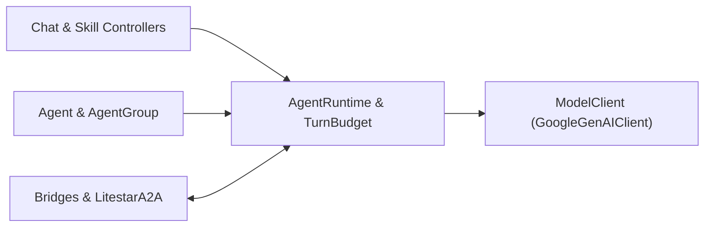

# Agent Framework & A2A Overview

`litestar-mcp` includes a provider-neutral multi-agent runtime, class-based prompt and skill controllers, bidirectional MCP/A2A protocol bridges, and an official Agent-to-Agent (`a2a-sdk` 1.0) transport plugin that run natively inside your Litestar application.

---

## Architectural Layers

The agent and interoperability stack is organized into five composable layers:



1. **Controllers (`PromptController`, `SkillController`, `AgentChatController`, `QueuedAgentChatController`)**: Class-based boundaries mirroring Litestar's `Controller` architecture to package domain prompts (`@prompt`), tools (`@tool`), instructions, authorization guards, universal dependency injection (`Provide`, `Dependency`, `FromDishka[T]`, `ToolContext`), and HTTP/SSE turn endpoints.
2. **Agent Hierarchy (`Agent`, `AgentGroup`, `AgentMessage`)**: Provider-neutral agent specifications and coordinator-specialist trees featuring automatic, `Literal`-typed `transfer_to_agent` handoff tool synthesis and non-mutating specialist isolation.
3. **Runtime & Model Layer (`AgentRuntime`, `TurnBudget`, `ModelClient`, `GoogleGenAIClient`, `MockModelClient`, `SessionStore`)**: Guarded multi-step execution loops enforcing `TurnBudget` limits (`max_turns`, `max_tool_calls`, `timeout_seconds`), streaming `ModelDelta` chunks from `GoogleGenAIClient` (defaulting to `gemini-3.8-flash` with thought-signature preservation, Vertex AI support, and shared `httpx2.AsyncClient` pooling), persisting transcripts in owner-scoped `MemorySessionStore` or `LitestarStoreSessionStore` backends, and emitting typed `AgentStreamFrame` Server-Sent Events.
4. **Bidirectional Protocol Bridges (`agent_to_mcp`, `mcp_to_tools`, `discover_mcp_tools`, `agent_to_a2a`)**: Zero-boilerplate adapters connecting marked Litestar MCP routes, remote Streamable HTTP MCP servers (`MCPStreamableHTTPClient`), local `Agent` or `AgentGroup` runtimes, and A2A 1.0 endpoints.
5. **Official A2A 1.0 Adapter (`LitestarA2A`, `A2AConfig`)**: First-party Litestar plugin wrapping `a2a-sdk` (`>=1.1.4`) `DefaultRequestHandler`, `AgentExecutor`, and `TaskStore` contracts across `/.well-known/agent-card.json` discovery, JSON-RPC 2.0 (`POST /a2a`), and native A2A 1.0 `HTTP+JSON` REST routes with `/{tenant:str}` path parameters and `X-A2A-Tenant` header multi-tenancy.

--8<-- "tools/docs/includes/diagram-agent-runtime-and-bridges.html"

---

## Installation

The core `Agent`, `AgentGroup`, `AgentRuntime`, `TurnBudget`, `SessionStore`, `AgentChatController`, `MockModelClient`, and MCP protocol bridges (`agent_to_mcp`, `mcp_to_tools`, `discover_mcp_tools`) ship in the base `litestar-mcp` package. Install the `google-genai` and `a2a` extras to unlock `GoogleGenAIClient` and `LitestarA2A` / `agent_to_a2a`:

=== "uv"

    ```bash
    uv add "litestar-mcp[google-genai]"
    uv add "litestar-mcp[a2a]"
    uv add "litestar-mcp[google-genai,a2a]"
    ```

=== "pip"

    ```bash
    pip install "litestar-mcp[google-genai]"
    pip install "litestar-mcp[a2a]"
    pip install "litestar-mcp[google-genai,a2a]"
    ```

=== "pdm"

    ```bash
    pdm add "litestar-mcp[google-genai]"
    pdm add "litestar-mcp[a2a]"
    pdm add "litestar-mcp[google-genai,a2a]"
    ```

=== "poetry"

    ```bash
    poetry add "litestar-mcp[google-genai]"
    poetry add "litestar-mcp[a2a]"
    poetry add "litestar-mcp[google-genai,a2a]"
    ```

---

## Universal Dependency Injection Across Tools & Skills

Tools decorated with `@tool`, `SkillController` methods, and `PromptController` methods support four dependency injection mechanisms across HTTP routes, MCP `tools/call` / `prompts/get`, and `AgentRuntime` turns:

| Mechanism | Declaration Syntax | Schema Behavior & Resolution |
| :--- | :--- | :--- |
| **Litestar Native DI** | `dependencies={"svc": Provide(...)}` on controller, router, app, or `@tool(dependencies=...)` | Excluded from tool JSON Schema; resolved via Litestar `Provide` callables or async generators |
| **Litestar Dependency Marker** | `svc: Annotated[Service, Dependency(skip_validation=True)]` parameter annotation | Excluded from tool JSON Schema; resolved from the active Litestar dependency graph |
| **Dishka** | `svc: FromDishka[Service]` parameter annotation on `@tool` or `@prompt` | Excluded from tool JSON Schema; resolved from the active request or application Dishka container |
| **Custom Resolver Hook** | `ToolContext(container=..., dependency_resolver=...)` | Invokes `dependency_resolver(param_name, type_hint, ctx)` per injected parameter during standalone execution |

---

## Guides in This Section

| Guide | Topics Covered |
| :--- | :--- |
| [**Agent Runtime & Turn Budgets**](runtime-and-budgets.md) | `Agent`, `@tool`, `ToolContext`, `AgentRuntime` plugin and `runtime` dependency, `TurnBudget` & `BudgetExceededError`, `ModelClient`, `MockModelClient`, and `GoogleGenAIClient` (`gemini-3.8-flash`) |
| [**Agent Groups & Handoffs**](groups-and-handoffs.md) | `AgentGroup(coordinator=..., specialists=[...])`, automatic `Literal`-typed `transfer_to_agent` synthesis, non-mutating specialist isolation, and the runnable Coffee Shop example |
| [**Sessions & SSE Streaming**](sessions-and-streaming.md) | `SessionStore`, `MemorySessionStore`, `LitestarStoreSessionStore`, strict `owner_id` IDOR prevention, `AgentChatController`, `QueuedAgentChatController`, `Last-Event-ID` cursor replay, and `AgentStreamFrame` events |
| [**Protocol Bridges**](protocol-bridges.md) | Bidirectional interoperability with `agent_to_mcp`, `mcp_to_tools`, `discover_mcp_tools` (`MCPStreamableHTTPClient`), and `agent_to_a2a` |
| [**A2A 1.0 Protocol & HTTP+JSON**](a2a-protocol.md) | `LitestarA2A`, `A2AConfig`, `/.well-known/agent-card.json` (`ETag`, `Cache-Control`, `agent_card_route_opt`), JSON-RPC 2.0 (`POST /a2a`), `HTTP+JSON` REST routes, `stream_cleanup_timeout`, and `a2a_activated_extensions` |
| [**Multi-Tenant A2A Routing**](multi-tenancy.md) | `/{tenant:str}` path parameters, `X-A2A-Tenant` header fallback, authoritative `context_builder(request, context)`, principal `user_name` resolution, and owner-scoped `TaskStore` isolation |
| [**Queued Agent Turns**](../queues/queued-agent-turns.md) | `QueuedAgentChatController`, `QueuedTurnManager`, `PrincipalSnapshot`, `AgentRegistry`, `ChannelsPlugin` history replay, and `Last-Event-ID` SSE resumption |
| [**Durable DAG Workflows**](../queues/durable-workflows.md) | `DynamicWorkflow`, `WorkflowNode`, in-process `WorkflowEngine`, distributed `DurableWorkflowEngine`, and single-writer `WorkflowStore` |
