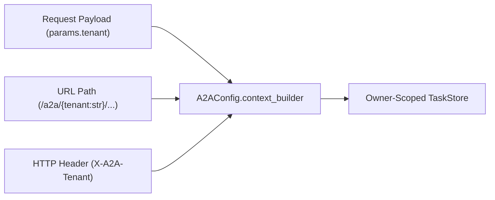

# Multi-Tenant A2A Routing

`LitestarA2A` supports multi-tenant agent deployments out of the box, combining URL path parameters (`/a2a/{tenant:str}`), payload tenant fields, and the `X-A2A-Tenant` request header with authoritative `context_builder` authorization and owner-scoped `TaskStore` isolation.

--8<-- "tools/docs/includes/diagram-a2a-interoperability.html"

---

## Tenant Resolution Precedence

On every incoming JSON-RPC or `HTTP+JSON` request, `_JsonRpcTransport._resolve_tenant` resolves the initial `ServerCallContext.tenant` string using the precedence order `request payload > /{tenant:str} URL path > X-A2A-Tenant header`:



1. **Explicit Request Payload (`params.tenant`)**: If the parsed A2A protobuf request message carries a non-empty `tenant` field (for example `SendMessageRequest.tenant` or `GetTaskRequest.tenant`), that value is used first.
2. **URL Path Parameter (`request.path_params["tenant"]`)**: Every route mounted by `LitestarA2A` registers both a base path and a tenant-parameterized path:
   - JSON-RPC 2.0: `POST /a2a` and `POST /a2a/{tenant:str}`
   - `HTTP+JSON` REST: `POST /a2a/{tenant:str}/message:send`, `POST /a2a/{tenant:str}/message:stream`, `GET /a2a/{tenant:str}/tasks`, `GET /a2a/{tenant:str}/tasks/{id}`, `POST /a2a/{tenant:str}/tasks/{id}:cancel`, `POST /a2a/{tenant:str}/tasks/{id}:subscribe`, and push notification config routes.
   You can also configure `A2AConfig(path="/{tenant:str}/a2a")` if your deployment places the tenant prefix at the root of the URL hierarchy.
3. **Fallback HTTP Header (`A2AConfig.tenant_header`)**: When neither the payload nor the URL path specifies a tenant, `LitestarA2A` reads the header named by `A2AConfig.tenant_header` (default `"X-A2A-Tenant"`). Set `tenant_header=None` to disable header fallback.

---

## Authoritative Context Builder Validation

A tenant string supplied in a URL path, header, or payload is an **untrusted claim** until verified against the caller's authenticated identity. Configure `A2AConfig(context_builder=...)` to validate tenant membership and enrich `ServerCallContext`:

```python title="docs/examples/snippets/a2a_http_json_multitenant.py"
--8<-- "docs/examples/snippets/a2a_http_json_multitenant.py:example"
```

### Prepared ServerCallContext Contract

Before invoking `context_builder(request, context)`, `LitestarA2A` populates `context` with:

| `ServerCallContext` Property | Initial Value |
| :--- | :--- |
| `context.user` | `_LitestarUser(request.scope.get("user"))` wrapping the Litestar principal |
| `context.tenant` | Candidate tenant string resolved from payload, `path_params["tenant"]`, or `X-A2A-Tenant` |
| `context.requested_extensions` | Set of extension URIs parsed from `A2A-Extensions` request headers |
| `context.state["auth"]` | `request.scope.get("auth")` |
| `context.state["headers"]` | `dict(request.headers)` |
| `context.state["litestar_state"]` | `request.scope.get("state", {})` |
| `context.state["method"]` | Canonical A2A 1.0 method name (for example `"SendMessage"`, `"GetTask"`, `"CancelTask"`) |
| `context.state["request_id"]` | JSON-RPC request ID (or `None` on `HTTP+JSON` REST calls) |

`context_builder` may return the updated `ServerCallContext` synchronously or asynchronously. The returned `ServerCallContext` is authoritative: `LitestarA2A` never overwrites `context.tenant`, `context.user`, or `context.state` with raw request values after `context_builder` runs. If `context_builder` raises a Litestar `HTTPException` (such as `NotAuthorizedException` or `PermissionDeniedException`), `LitestarA2A` propagates the HTTP status and response headers directly to the client.

---

## Principal User Name Resolution & Collision Guard

The A2A SDK's owner-scoped stores (`InMemoryTaskStore` and `InMemoryPushNotificationConfigStore`) identify callers through `context.user.is_authenticated` and `context.user.user_name`.

`LitestarA2A` wraps `request.scope.get("user")` in `_LitestarUser`, which resolves `user_name` by inspecting the principal (whether an object or a `dict`) for the first non-null attribute or key in:

1. `id`
2. `sub`
3. `username`

If `user.is_authenticated` is `True` (which defaults to `True` whenever `request.scope.get("user")` is not `None`, unless the principal defines `is_authenticated = False`) **and** none of `id`, `sub`, or `username` is present on the principal, `user.user_name` would be empty `""`—causing all authenticated users to share the anonymous task owner key. To prevent cross-user data leakage, `LitestarA2A` raises a `RuntimeError` (`InternalError` on the wire) unless your `context_builder` assigns a custom `a2a.auth.user.User` with a non-empty `user_name` to `context.user`.

---

## Owner-Scoped TaskStore Isolation

In a multi-tenant deployment, tenant and principal isolation must hold across every task lifecycle operation (`SendMessage`, `GetTask`, `ListTasks`, `CancelTask`, `SubscribeToTask`, and push notification config CRUD).

The reference application in `docs/examples/a2a_application/main.py` demonstrates production-grade tenant and principal scoping with the official `a2a-sdk`:

### Authentication Middleware, Context Builder, and Owner Resolver

```python title="docs/examples/a2a_application/main.py"
--8<-- "docs/examples/a2a_application/main.py:80:117"
```

- **`authorize_context`**: Calls `await request.user.authorize_workspace(context.tenant)` so any request naming an unauthorized workspace fails with `PermissionDeniedException` (`HTTP 403`) before reaching `DefaultRequestHandler`.
- **`resolve_owner`**: Encodes `[context.tenant, context.user.user_name]` as a compact JSON array (`json.dumps([context.tenant, context.user.user_name], separators=(",", ":"))`). Using structured JSON serialization prevents delimiter-collision attacks where a tenant named `"alpha:alice"` and user `"bob"` could otherwise collide with tenant `"alpha"` and user `"alice:bob"`.

### Wiring Scoped Stores and Executor Lifetimes

```python title="docs/examples/a2a_application/main.py"
--8<-- "docs/examples/a2a_application/main.py:218:270"
```

Key architectural invariants for multi-tenant `TaskStore` implementations:

- **Share `owner_resolver` Across Task and Push Stores**: Pass the exact same `owner_resolver=resolve_owner` function to both `InMemoryTaskStore` and `InMemoryPushNotificationConfigStore` so push notification configurations are bound to the same `(tenant, user_name)` boundary as tasks.
- **Globally Unique Task IDs & Immutable Ownership**: Because `DefaultRequestHandler` tracks active in-flight tasks and push dispatch globally by `task_id`, custom persistent `TaskStore` backends must enforce globally unique task IDs and immutable `(tenant, user_name)` ownership across all tenants.
- **Live Cancellation & Subscription Checks**: From `a2a-sdk>=1.1.4`, `DefaultRequestHandler` verifies task existence in the owner-scoped `task_store` before attaching to an active task queue for `CancelTask` or `SubscribeToTask`, ensuring a caller in Tenant B cannot cancel or subscribe to an in-flight task created by Tenant A.
