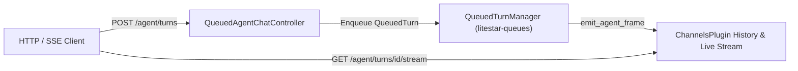

# Sessions & SSE Streaming

`litestar_mcp.agent` persists multi-turn conversation history through the pluggable `SessionStore` protocol (`MemorySessionStore` and `LitestarStoreSessionStore`), enforces strict owner isolation against Insecure Direct Object Reference (IDOR) attacks, and streams typed `AgentStreamFrame` events over Server-Sent Events (SSE) via `AgentChatController` and `QueuedAgentChatController`.

---

## SessionStore Protocol & Backends

Every conversation transcript is a sequence of `AgentMessage` (`msgspec.Struct`) records keyed by `(owner, session_id)`:

```python
from collections.abc import Sequence
from contextlib import AbstractAsyncContextManager
from typing import Protocol
from litestar_mcp.agent import AgentMessage


class SessionStore(Protocol):
    async def load(self, owner: str, session_id: str) -> list[AgentMessage] | None: ...
    async def save(self, owner: str, session_id: str, messages: Sequence[AgentMessage]) -> None: ...
    def lock(self, owner: str, session_id: str) -> AbstractAsyncContextManager[None]: ...
```

`AgentRuntime.produce` acquires `async with self.sessions.lock(store_owner, sid):` before loading history, running the multi-turn model/tool loop, and saving the updated transcript. Concurrent requests targeting the same `(owner, session_id)` serialize cleanly rather than overwriting each other's turns.

### Backend Comparison

| Implementation | Storage Backend | Concurrency & Eviction | Best For |
| :--- | :--- | :--- | :--- |
| **`MemorySessionStore`** | Process-local `OrderedDict[tuple[str, str], tuple[float, list[AgentMessage]]]` | Per-`(owner, session_id)` `anyio.Lock`; LRU capacity eviction (`max_sessions=1024`) and monotonic TTL expiry (`ttl_seconds=3600.0`) | Local development, single-worker processes, and unit tests |
| **`LitestarStoreSessionStore`** | Any Litestar `Store` in `StoreRegistry` (`RedisStore`, `FileStore`, `MemoryStore`) | Per-key `anyio.Lock`; JSON encoding via `litestar.serialization.encode_json` / `decode_json` with backend `expires_in=ttl_seconds` (`3600`) under `{key_prefix}:{owner}:{session_id}` | Multi-replica production deployments sharing a Redis or persistent Litestar `Store` |

### Wiring LitestarStoreSessionStore

Pass any Litestar `Store` instance to `LitestarStoreSessionStore` (`litestar_mcp.agent.sessions.LitestarStoreSessionStore`) and supply it to `AgentRuntime(sessions=...)`:

```python
from litestar import Litestar
from litestar.stores.memory import MemoryStore
from litestar_mcp.agent import Agent, AgentChatController, AgentRuntime
from litestar_mcp.agent.sessions import LitestarStoreSessionStore

session_backing_store = MemoryStore()
session_store = LitestarStoreSessionStore(
    store=session_backing_store,
    ttl_seconds=7200,
    key_prefix="litestar_mcp:session",
)

assistant = Agent(name="assistant", instructions="You are a concise technical assistant.")
app = Litestar(
    route_handlers=[AgentChatController],
    plugins=[AgentRuntime(assistant, sessions=session_store)],
)
```

---

## Owner Isolation & IDOR Prevention

`AgentRuntime` partitions every session by an authenticated owner key resolved from `ToolContext.owner_key()`:

1. **Authenticated Principals (`"<tenant_or_default>:<user_id>"`)**: When authentication middleware populates `request.user` or `request.auth`, `ToolContext.owner_key()` extracts the principal's identifier (`id`, `sub`, `username`, or `pk`) and optional `tenant_id` (defaulting to `"default"`). Because `store_owner` is part of the storage lookup key (`(owner, session_id)` in `MemorySessionStore` and `{key_prefix}:{owner}:{session_id}` in `LitestarStoreSessionStore`), User A cannot load, append to, or inspect a `session_id` belonging to User B—even if User A knows the exact UUID.
2. **Anonymous Callers (`ANONYMOUS_OWNER = "anonymous"`)**: When a request is unauthenticated (`turn.context.owner_key() is None`), `AgentRuntime._resolve_session` enforces server-minted session identifiers:
   - If the anonymous caller omits `session_id`, the runtime generates a fresh `uuid4().hex`.
   - If the anonymous caller supplies a `session_id`, the runtime checks whether `(ANONYMOUS_OWNER, turn.session_id)` already exists in `SessionStore`. If it does not exist, the runtime ignores the client-supplied value and mints a fresh `uuid4().hex`, preventing anonymous callers from pre-seeding predictable session IDs.

---

## HTTP & SSE Streaming with AgentChatController

Mounting `AgentChatController` (`litestar_mcp.agent.AgentChatController`) on your `Litestar` application exposes three endpoints under `/agent` backed by the injected `runtime: NamedDependency[AgentRuntime]`:

| Endpoint | Request / Response Model | Description |
| :--- | :--- | :--- |
| `POST /agent/chat` | `ChatRequest` &rarr; `ServerSentEvent` (`text/event-stream`) | Streams live `AgentStreamFrame` events for the turn with `StreamCleanupMiddleware` disconnect cleanup and periodic `ping` frames every `15.0` seconds (`ping_interval`). |
| `POST /agent/turns` | `ChatRequest` &rarr; `TurnResult` (`application/json`) | Executes the turn synchronously to completion and returns `{session_id, turn_id, agent_name, output, messages, token_usage}` (or HTTP `504` on `BudgetExceededError`). |
| `GET /agent/sessions/{session_id:str}` | `FromPath[str]` &rarr; `SessionHistory` (`application/json`) | Returns `{session_id, messages}` for the authenticated owner's session, or raises `SessionNotFoundError` (`HTTP 404`) when the session does not exist for that owner. |

`ChatRequest` (`msgspec.Struct`, `forbid_unknown_fields=True`) accepts:

- `message: str`: User prompt text initiating the turn.
- `session_id: str | None = None`: Optional existing session ID to resume.
- `dynamic_context: str | None = None`: Optional per-turn context prepended to the active agent's system instructions.

---

## Background Streaming & Cursor Replay

For long-running agent turns distributed across background workers via `litestar-queues` (`litestar-mcp[queues]`), `QueuedAgentChatController` (`litestar_mcp.queues.QueuedAgentChatController`) decouples turn submission from SSE consumption:



- **`POST /agent/turns` (`202 Accepted`)**: Captures a `PrincipalSnapshot` (`user_id`, `tenant`, `roles`, `scopes`) from the request, enqueues `run_agent_turn` onto the `"agent"` queue via `QueuedTurnManager`, and immediately returns:
  ```json
  {
    "session_id": "9b1deb4d3b7d4bad9bdd2b0d7b3dcb6d",
    "turn_id": "4f8a2c1e9d0b4a7f8c3e1d2a5b6c7d8e",
    "stream_url": "/agent/turns/4f8a2c1e9d0b4a7f8c3e1d2a5b6c7d8e/stream"
  }
  ```
- **`GET /agent/turns/{turn_id:str}/stream` (Live SSE + Replay)**: Subscribes to the turn's Litestar `ChannelsPlugin` topic (`litestar_mcp:agent:{turn_id}`) with `history=1000` (`replay_limit`), replays buffered `AgentStreamFrame` events in monotonic `seq` order, deduplicates frames (`frame.seq <= last_seq`), and terminates automatically when a terminal event (`complete` or `error`) arrives.
- **SSE `id` & `Last-Event-ID` Cursor Recovery**: Every `AgentStreamFrame` encodes its 1-based sequence counter (`frame.seq`) as the standard SSE `id:` field (`ServerSentEventMessage(id=str(self.seq), event=self.event_type, data=...)`). Reconnecting SSE clients can resume from their last seen `seq` cursor without duplicate processing.

---

## Typed AgentStreamFrame Events

Every SSE message emitted by `AgentRuntime`, `AgentChatController`, and `QueuedAgentChatController` serializes an `AgentStreamFrame` (`litestar_mcp.agent.AgentStreamFrame`):

| `event_type` | Terminal | Populated Fields | Wire Meaning |
| :--- | :--- | :--- | :--- |
| `session` | No | `turn_id`, `seq=1`, `agent_name`, `payload={"session_id": ..., "turn_id": ...}` | First frame emitted at turn start identifying the resolved `session_id` and `turn_id`. |
| `thought` | No | `turn_id`, `seq`, `agent_name`, `text` | Incremental reasoning trace emitted by a thinking model (such as `gemini-3.8-flash`). |
| `delta` | No | `turn_id`, `seq`, `agent_name`, `text` | Incremental assistant response text chunk. |
| `tool_call` | No | `turn_id`, `seq`, `agent_name`, `tool_name`, `call_id`, `payload` (arguments dict) | Model requested a tool invocation. |
| `tool_result` | No | `turn_id`, `seq`, `agent_name`, `tool_name`, `call_id`, `payload` (`{call_id, name, content, is_error}`) | Tool execution completed and returned a result or error dict. |
| `agent_transfer` | No | `turn_id`, `seq`, `agent_name` (target specialist), `payload={"reason": ...}` | Coordinator handed control to a specialist agent in an `AgentGroup`. |
| `ping` | No | `turn_id`, `event_type="ping"` | Keepalive frame emitted when no model or tool frame arrives within `ping_interval` (`15.0s`). |
| `complete` | Yes | `turn_id`, `seq`, `agent_name`, `payload={"output": ..., "token_usage": ...}` | Turn finished normally; `payload` contains the full concatenated output and token usage counts. |
| `error` | Yes | `turn_id`, `seq`, `agent_name`, `payload={"error": ...}` | Turn aborted due to `BudgetExceededError` or an unhandled runtime exception. |

### Consuming Streams in Python

Use `iter_agent_stream` (`litestar_mcp.agent.iter_agent_stream`) with an `httpx2.AsyncClient` streaming response to decode SSE events directly into typed `AgentStreamFrame` structs:

```python
import httpx2
from litestar_mcp.agent import iter_agent_stream


async def stream_chat(client: httpx2.AsyncClient, prompt_text: str) -> str:
    """Stream an agent turn and return the final completed output."""
    chunks: list[str] = []
    async with client.stream(
        "POST",
        "http://localhost:8000/agent/chat",
        json={"message": prompt_text},
    ) as response:
        async for frame in iter_agent_stream(response):
            if frame.event_type == "delta" and frame.text:
                chunks.append(frame.text)
            elif frame.event_type == "complete":
                break
    return "".join(chunks)
```
