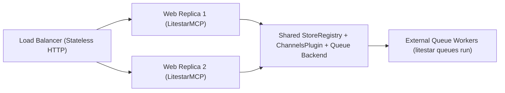

# Multi-Replica Production Deployment

Deploying `litestar-mcp` across multiple web and worker replicas behind a load balancer requires coordinating four shared state planes:

1. **Stateless HTTP Routing & Origin Validation** (`MCPConfig.allowed_origins`)
2. **Shared `StoreRegistry`** (`litestar_mcp_tasks`, `litestar_mcp_workflows`, `LitestarStoreSessionStore`)
3. **Cross-Worker `ChannelsPlugin`** (`MCPConfig.subscription_channels` and `QueuedAgentChatController`)
4. **Durable `litestar-queues` Backend & External Worker Placement** (`WorkerConfig(placement="external")`)



---

## Stateless Streamable HTTP & Allowed Origins

`LitestarMCP` serves Streamable HTTP on `MCPConfig.base_path` (default `/mcp`) without requiring sticky load-balancer sessions:

- **Stateless `2026-07-28` & `2025-06-18` Routing**: Every `POST /mcp` JSON-RPC request (`server/discover`, `initialize`, `tools/list`, `tools/call`, `resources/read`, `prompts/get`, `skills/*`, `tasks/*`) and `DELETE /mcp` request is self-contained. Any web replica can handle any request in a sequence.
- **Browser & Cross-Origin Protection (`MCPConfig.allowed_origins`)**: To prevent DNS rebinding and cross-origin CSRF attacks from browser contexts, `MCPController` validates the `Origin` header on incoming requests whenever `Origin` is present. By default, only requests matching the server's own origin (`scheme://host[:port]`) are accepted; mismatched origins receive HTTP `403 Forbidden`. In production behind an API gateway or hosted web inspector, list trusted origins explicitly:

```python
from litestar_mcp import MCPConfig

config = MCPConfig(
    allowed_origins=[
        "https://mcp-inspector.internal.example.com",
        "https://app.example.com",
    ],
)
```

---

## Shared StoreRegistry for Tasks, Workflows & Sessions

By default, Litestar initializes an in-memory `MemoryStore` when no `stores` registry is configured. In a multi-replica deployment, a process-local `MemoryStore` causes `tasks/get`, `tasks/update`, `tasks/cancel`, `workflow_engine.snapshot()`, and multi-turn agent sessions to fail with not-found errors when routed to a different replica.

Configure a shared `StoreRegistry` (such as Litestar's `RedisStore`) on `Litestar(stores=...)`:

| Store Consumer | Store Resolution Mechanism | Default Store Name / Key Prefix |
| :--- | :--- | :--- |
| **`MCPTaskStore`** (`io.modelcontextprotocol/tasks`) | Automatically resolves `"litestar_mcp_tasks"` from `app.stores` when `MCPTaskConfig.store` is `None`. | Store name `"litestar_mcp_tasks"`, keys `mcp-task:{task_id}` and `mcp-task:{task_id}:job` |
| **`WorkflowStore`** (`DurableWorkflowEngine`) | Automatically resolves `"litestar_mcp_workflows"` from `app.stores` when `DurableWorkflowEngine.store` is `None`. | Store name `"litestar_mcp_workflows"`, keys `litestar_mcp:workflow:{run_id}:run` and `litestar_mcp:workflow:{run_id}:node:{name}` |
| **`LitestarStoreSessionStore`** (`AgentRuntime`) | Pass a shared `Store` instance explicitly: `LitestarStoreSessionStore(redis_store.with_namespace("sessions"))`. | Key prefix `litestar_mcp:session:{owner}:{session_id}` |

```python
from litestar import Litestar
from litestar.stores.redis import RedisStore
from litestar.stores.registry import StoreRegistry

from litestar_mcp import LitestarMCP, MCPConfig
from litestar_mcp.agent import Agent, AgentRuntime
from litestar_mcp.agent.sessions import LitestarStoreSessionStore

root_redis_store = RedisStore.with_client(url="redis://redis.internal:6379/0")

stores = StoreRegistry(
    default_factory=root_redis_store.with_namespace,
)

agent = Agent(name="assistant", instructions="Assist the authenticated user.")
runtime = AgentRuntime(
    target=agent,
    sessions=LitestarStoreSessionStore(root_redis_store.with_namespace("litestar_mcp_sessions")),
)

app = Litestar(
    stores=stores,
    plugins=[
        LitestarMCP(MCPConfig(tasks=True)),
        runtime,
    ],
)
```

Because `StoreRegistry(default_factory=root_redis_store.with_namespace)` automatically namespaces every store lookup, `LitestarMCP` resolves `"litestar_mcp_tasks"` and `DurableWorkflowEngine` resolves `"litestar_mcp_workflows"` against Redis with zero boilerplate.

---

## Cross-Worker ChannelsPlugin

Two real-time streaming subsystems use Litestar's `ChannelsPlugin` to fan out events across processes:

1. **MCP Resource & Task Notifications (`MCPConfig.subscription_channels`)**: When a worker or web replica calls `registry.notify_resource_updated(uri)` or transitions a task in `MCPTaskStore` (`notifications/tasks`), `SubscriptionManager` publishes the notification across replicas when `MCPConfig(subscription_channels=channels_plugin)` is configured.
2. **Queued Agent Turn SSE (`QueuedAgentChatController`)**: Workers running `run_agent_turn_task` publish sequenced `AgentStreamFrame` payloads to `litestar_mcp:agent:{turn_id}` via `ChannelsPlugin` (configured with a shared Redis pub/sub backend and `history` enabled).

```python
from litestar.channels import ChannelsPlugin
from litestar.channels.backends.redis import RedisChannelsPubSubBackend

from litestar_mcp import MCPConfig

channels_plugin = ChannelsPlugin(
    backend=RedisChannelsPubSubBackend(url="redis://redis.internal:6379/0", history=1000),
    arbitrary_channels_allowed=True,
)

mcp_config = MCPConfig(
    tasks=True,
    subscription_channels=channels_plugin,
)
```

---

## Durable Queue Backends & Worker Placement

For multi-replica production deployments, configure `QueuePlugin` with a durable backend (such as Redis or SQLSpec PostgreSQL) and decouple web replicas from queue workers using `WorkerConfig(placement="external")`:

| `WorkerConfig.placement` | Execution Model | When to Use |
| :--- | :--- | :--- |
| **`"external"`** *(Recommended for Production)* | Web replicas only enqueue tasks, cancel jobs, and serve HTTP/SSE requests. Dedicated worker containers claim and execute tasks via `litestar queues run`. | Multi-replica production deployments, Kubernetes / Cloud Run worker pools, and CPU- or LLM-heavy workloads. |
| **`"server"`** / **`"asgi"`** | Background queue workers start inside the same ASGI server lifespan as the web application. | Single-container deployments, staging previews, and local development. |

### Production Configuration

```python
from litestar import Litestar
from litestar_queues import QueueConfig, QueuePlugin, WorkerConfig
from litestar_queues.backends.redis import RedisBackendConfig

from litestar_mcp import LitestarMCP, MCPConfig

queue_plugin = QueuePlugin(
    config=QueueConfig(
        queue_backend="redis",
        backend_config=RedisBackendConfig(url="redis://redis.internal:6379/0"),
        worker=WorkerConfig(
            placement="external",
            run_app_lifespan=True,
            queues=("mcp", "workflow", "agent", "heavy"),
            max_concurrency=8,
        ),
    ),
)

app = Litestar(
    plugins=[
        queue_plugin,
        LitestarMCP(MCPConfig(tasks=True)),
    ],
)
```

!!! note
    Always keep `WorkerConfig(run_app_lifespan=True)` enabled for external workers. Running the Litestar application lifespan ensures `LitestarMCP.on_startup` binds `MCPTaskRuntime` to `QueueTaskExecutor`, opens shared `StoreRegistry` and `ChannelsPlugin` connections, and initializes database pools or Dishka containers before the worker claims its first job.

### Launching Web Replicas and External Workers

Run stateless web replicas with Uvicorn or Gunicorn, and launch dedicated queue worker processes from the same application entrypoint using `litestar queues run`:

=== "Web Replicas"

    ```bash
    uvicorn app:app --host 0.0.0.0 --port 8000 --workers 4
    ```

=== "External Queue Workers"

    ```bash
    litestar --app app:app queues run
    ```

---

## Production Readiness & Conformance Testing

Before promoting a deployment configuration to production, verify protocol compliance against the official MCP `2026-07-28` conformance suite under both in-process and distributed `QueueTaskExecutor` modes:

| Target | Command | What It Verifies |
| :--- | :--- | :--- |
| **In-Process Conformance** | `make conformance` | Runs `tools/ci/run_mcp_conformance.py` against the MCP `2026-07-28` specification (`server/discover`, SEP-2575 headers, tools, resources, prompts, skills, and in-process tasks). |
| **Distributed Queue Conformance** | `make conformance-queue` | Runs `MCP_CONFORMANCE_TASK_EXECUTOR=queue python tools/ci/run_mcp_conformance.py`, verifying `QueueTaskExecutor`, principal/security rehydration, cooperative `tasks/cancel`, and multi-round `MCPInputRequiredResult` / `tasks/update` resumption over `litestar-queues`. |

### Multi-Replica Deployment Checklist Summary

| Component | Single-Process Default | Multi-Replica Production Requirement |
| :--- | :--- | :--- |
| **`Litestar(stores=...)`** | `MemoryStore` | Shared `StoreRegistry` (e.g. `RedisStore`) backing `"litestar_mcp_tasks"` and `"litestar_mcp_workflows"` |
| **`AgentRuntime.sessions`** | `MemorySessionStore` | `LitestarStoreSessionStore` bound to a shared `Store` namespace |
| **`MCPConfig.subscription_channels`** | `None` (process-local SSE) | Shared `ChannelsPlugin` (e.g. `RedisChannelsPubSubBackend`) |
| **`QueueConfig.queue_backend`** | `"ephemeral"` | Durable broker (`"redis"` or `"sqlspec"`) |
| **`WorkerConfig.placement`** | In-process worker | `"external"` launched via `litestar --app app:app queues run` with `run_app_lifespan=True` |
| **`MCPConfig.allowed_origins`** | Same-origin only | Explicit allowlist of trusted browser / gateway origins |
