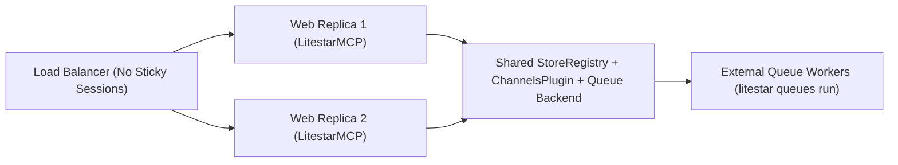

# Multi-Replica Production Deployment

Deploying `litestar-mcp` across multiple web and worker replicas behind a load balancer coordinates shared state and transport planes without requiring sticky load-balancer sessions:

1. **Dual-Mode Streamable HTTP & Origin Validation** (`2026-07-28` stateless + `2025-11-25` `Mcp-Session-Id`, `MCPConfig.allowed_origins`, `MCPConfig.enable_get_sse`)
2. **Shared `StoreRegistry`** (`litestar_mcp_tasks`, `litestar_mcp_workflows`, `litestar_mcp_sessions` for `MCPSessionStore`, and `"sessions"` for `LitestarStoreSessionStore`)
3. **Cross-Worker `ChannelsPlugin`** (`MCPConfig.subscription_channels`, `MCPConfig.subscription_authorizer`, and `QueuedAgentChatController`)
4. **Durable `litestar-queues` Backend & External Worker Placement** (`WorkerConfig(placement="external")`)



---

## Dual-Mode Streamable HTTP and Allowed Origins

`LitestarMCP` serves Streamable HTTP on `MCPConfig.base_path` (default `/mcp`) across stateless and session-backed protocol revisions without requiring load-balancer affinity:

- **Stateless `2026-07-28` Routing**: Every `2026-07-28` `POST /mcp` request (`server/discover`, SEP-2575 headers, `tools/*`, `resources/*`, `prompts/*`, `skills/*`, `tasks/*`, `subscriptions/listen`) and stateless `DELETE /mcp` call is completely self-contained with zero session headers.
- **Shared-Store `2025-11-25`, `2025-06-18`, and `2025-03-26` Session Routing (`Mcp-Session-Id`)**: Session-aware `initialize` handshakes issue an owner-bound `Mcp-Session-Id` stored in `MCPSessionStore` (`"litestar_mcp_sessions"`, expiring after `MCPConfig.session_ttl_seconds = 3600.0`) and stream server-initiated notifications over `GET /mcp` when `MCPConfig.enable_get_sse` is `True`. Because `MCPSessionStore` reads from the shared `StoreRegistry` and notifications fan out over `ChannelsPlugin`, any web replica can serve any `POST`, `GET`, or `DELETE` `/mcp` request for an active `Mcp-Session-Id`.
- **Browser & Cross-Origin Protection (`MCPConfig.allowed_origins`)**: To prevent DNS rebinding and cross-origin CSRF attacks from browser contexts, `MCPController` validates the `Origin` header on incoming requests whenever `Origin` is present. By default, only requests matching the server's own origin (`scheme://host[:port]`) are accepted; mismatched origins receive HTTP `403 Forbidden`. In production behind an API gateway or hosted web inspector, list trusted origins explicitly:

```python
from litestar_mcp import MCPConfig

config = MCPConfig(
    allowed_origins=[
        "https://mcp-inspector.internal.example.com",
        "https://app.example.com",
    ],
)
```

---

## Shared StoreRegistry for Tasks, Workflows & Sessions

By default, Litestar initializes an in-memory `MemoryStore` when no `stores` registry is configured. In a multi-replica deployment, a process-local `MemoryStore` causes `tasks/get`, `tasks/update`, `tasks/cancel`, `workflow_engine.snapshot()`, and multi-turn agent sessions to fail with not-found errors when routed to a different replica.

Configure a shared `StoreRegistry` (such as Litestar's `RedisStore`) on `Litestar(stores=...)`:

| Store Consumer | Store Resolution Mechanism | Default Store Name / Key Prefix |
| :--- | :--- | :--- |
| **`MCPTaskStore`** (`io.modelcontextprotocol/tasks`) | Automatically resolves `"litestar_mcp_tasks"` from `app.stores` when `MCPTaskConfig.store` is `None`. | Store name `"litestar_mcp_tasks"`, keys `mcp-task:{task_id}` and `mcp-task:{task_id}:job` |
| **`MCPSessionStore`** (`2025-11-25`, `2025-06-18`, `2025-03-26` `Mcp-Session-Id`) | Automatically resolves `"litestar_mcp_sessions"` from `app.stores` (`app.stores.get("litestar_mcp_sessions")`). Reserved strictly for MCP transport sessions. | Store name `"litestar_mcp_sessions"`, keys `mcp-session:{session_id}` (TTL `MCPConfig.session_ttl_seconds`, default `3600.0`s) |
| **`WorkflowStore`** (`DurableWorkflowEngine`) | Automatically resolves `"litestar_mcp_workflows"` from `app.stores` when `DurableWorkflowEngine.store` is `None`. | Store name `"litestar_mcp_workflows"`, keys `litestar_mcp:workflow:{run_id}:run` and `litestar_mcp:workflow:{run_id}:node:{name}` |
| **`LitestarStoreSessionStore`** (`AgentRuntime`) | Pass a dedicated namespace explicitly: `LitestarStoreSessionStore(root_redis_store.with_namespace("sessions"))` (never `"litestar_mcp_sessions"`). | Namespace `"sessions"`, key prefix `litestar_mcp:session:{owner}:{session_id}` |

```python
from litestar import Litestar
from litestar.stores.redis import RedisStore
from litestar.stores.registry import StoreRegistry

from litestar_mcp import LitestarMCP, MCPConfig
from litestar_mcp.agent import Agent, AgentRuntime
from litestar_mcp.agent.sessions import LitestarStoreSessionStore

root_redis_store = RedisStore.with_client(url="redis://redis.internal:6379/0")

stores = StoreRegistry(
    default_factory=root_redis_store.with_namespace,
)

agent = Agent(name="assistant", instructions="Assist the authenticated user.")
runtime = AgentRuntime(
    target=agent,
    sessions=LitestarStoreSessionStore(root_redis_store.with_namespace("sessions")),
)

app = Litestar(
    stores=stores,
    plugins=[
        LitestarMCP(MCPConfig(tasks=True)),
        runtime,
    ],
)
```

Because `StoreRegistry(default_factory=root_redis_store.with_namespace)` automatically namespaces every named store lookup, `LitestarMCP` resolves `"litestar_mcp_tasks"` and reserved `"litestar_mcp_sessions"` (`MCPSessionStore`, bounded by `MCPConfig.session_ttl_seconds`) and `DurableWorkflowEngine` resolves `"litestar_mcp_workflows"` against Redis automatically, while `AgentRuntime` keeps conversation transcripts isolated in its own `"sessions"` namespace.

---

## Cross-Worker ChannelsPlugin

Two real-time streaming subsystems use Litestar's `ChannelsPlugin` to fan out events across processes:

1. **MCP Notifications (`MCPConfig.subscription_channels`)**: Pass `MCPConfig(subscription_channels=channels_plugin)` explicitly—or let `QueueTaskExecutor.bind()` auto-discover the registered `ChannelsPlugin` when `subscription_channels` is `None`—so `SubscriptionManager` fans out notifications across web and worker replicas (`wait_published` is awaited when publishing so short-lived queue jobs flush events cleanly before teardown):
   - **Cluster-wide task & catalog events**: `MCPTaskStore.status_callback` publishes `notifications/tasks` over `ChannelsPlugin` without a restricting `session_id` (matched by `owner_id` and `taskIds` on `2026-07-28` `POST /mcp` `subscriptions/listen` streams and owner-matched `2025-*` `GET /mcp` SSE streams), alongside catalog `notifications/{tools,resources,prompts,skills}/list_changed` broadcasts.
   - **Principal & session-scoped progress and logs (`owner_id` + `session_id`)**: `notifications/progress` and RFC 5424 `notifications/message` events carry `owner_id` and `session_id`, delivering to the originating `2025-*` session `GET /mcp` SSE stream (`notifications/progress` is strictly excluded from `2026-07-28` `POST /mcp` `subscriptions/listen` task streams, while `notifications/message` only enters `2026-07-28` `subscriptions/listen` streams opted in with `"logLevel"`).
   - **Authorized resource updates (`owner_id` + `subscription_authorizer`)**: `notifications/resources/updated` events enforce `owner_id` isolation, active URI membership (`resources/subscribe` on `2025-*` `GET /mcp` SSE or `resourceSubscriptions` on `2026-07-28` `subscriptions/listen`), and fail-closed `MCPConfig.subscription_authorizer` checks.
2. **Queued Agent Turn SSE (`QueuedAgentChatController`)**: Workers running `run_agent_turn_task` publish sequenced `AgentStreamFrame` payloads to `litestar_mcp:agent:{turn_id}` via `ChannelsPlugin` (configured with a shared Redis pub/sub backend and `history` enabled).

```python
from litestar.channels import ChannelsPlugin
from litestar.channels.backends.redis import RedisChannelsPubSubBackend

from litestar_mcp import MCPConfig

channels_plugin = ChannelsPlugin(
    backend=RedisChannelsPubSubBackend(url="redis://redis.internal:6379/0", history=1000),
    arbitrary_channels_allowed=True,
)

mcp_config = MCPConfig(
    tasks=True,
    subscription_channels=channels_plugin,
)
```

---

## Durable Queue Backends & Worker Placement

For multi-replica production deployments, configure `QueuePlugin` with a durable backend (such as Redis or SQLSpec PostgreSQL) and decouple web replicas from queue workers using `WorkerConfig(placement="external")`:

| `WorkerConfig.placement` | Execution Model | When to Use |
| :--- | :--- | :--- |
| **`"external"`** *(Recommended for Production)* | Web replicas only enqueue tasks, cancel jobs, and serve HTTP/SSE requests. Dedicated worker containers claim and execute tasks via `litestar queues run`. | Multi-replica production deployments, Kubernetes / Cloud Run worker pools, and CPU- or LLM-heavy workloads. |
| **`"server"`** / **`"asgi"`** | Background queue workers start inside the same ASGI server lifespan as the web application. | Single-container deployments, staging previews, and local development. |

### Production Configuration

```python
from litestar import Litestar
from litestar_queues import QueueConfig, QueuePlugin, WorkerConfig
from litestar_queues.backends.redis import RedisBackendConfig

from litestar_mcp import LitestarMCP, MCPConfig

queue_plugin = QueuePlugin(
    config=QueueConfig(
        queue_backend="redis",
        backend_config=RedisBackendConfig(url="redis://redis.internal:6379/0"),
        worker=WorkerConfig(
            placement="external",
            run_app_lifespan=True,
            queues=("mcp", "workflow", "agent", "heavy"),
            max_concurrency=8,
        ),
    ),
)

app = Litestar(
    plugins=[
        queue_plugin,
        LitestarMCP(MCPConfig(tasks=True)),
    ],
)
```

!!! note
    Always keep `WorkerConfig(run_app_lifespan=True)` enabled for external workers. Running the Litestar application lifespan ensures `LitestarMCP.on_startup` binds `MCPTaskRuntime` to `QueueTaskExecutor`, opens shared `StoreRegistry` and `ChannelsPlugin` connections, and initializes database pools or Dishka containers before the worker claims its first job.

### Launching Web Replicas and External Workers

Run stateless web replicas with Uvicorn or Gunicorn, and launch dedicated queue worker processes from the same application entrypoint using `litestar queues run`:

=== "Web Replicas"

    ```bash
    uvicorn app:app --host 0.0.0.0 --port 8000 --workers 4
    ```

=== "External Queue Workers"

    ```bash
    litestar --app app:app queues run
    ```

---

## Production Readiness & Conformance Testing

Before promoting a deployment configuration to production, verify protocol compliance against the official MCP `2026-07-28` conformance suite under both in-process and distributed `QueueTaskExecutor` modes:

| Target | Command | What It Verifies |
| :--- | :--- | :--- |
| **In-Process Conformance** | `make conformance` | Runs `tools/ci/run_mcp_conformance.py` against the MCP `2026-07-28` specification (`server/discover`, SEP-2575 headers, tools, resources, prompts, skills, and in-process tasks). |
| **Distributed Queue Conformance** | `make conformance-queue` | Runs `MCP_CONFORMANCE_TASK_EXECUTOR=queue python tools/ci/run_mcp_conformance.py`, verifying `QueueTaskExecutor`, principal/security rehydration, cooperative `tasks/cancel`, and multi-round `MCPInputRequiredResult` / `tasks/update` resumption over `litestar-queues`. |

### Multi-Replica Deployment Checklist Summary

| Component | Single-Process Default | Multi-Replica Production Requirement |
| :--- | :--- | :--- |
| **`Litestar(stores=...)`** | `MemoryStore` | Shared `StoreRegistry` (e.g. `RedisStore`) backing `"litestar_mcp_tasks"`, `"litestar_mcp_workflows"`, and reserved `"litestar_mcp_sessions"` (`MCPSessionStore`, key `mcp-session:{session_id}`) |
| **`AgentRuntime.sessions`** | `MemorySessionStore` | `LitestarStoreSessionStore` bound to a separate `"sessions"` `Store` namespace (distinct from `"litestar_mcp_sessions"`) |
| **`MCPConfig.subscription_channels`** | `None` (process-local SSE) | Shared `ChannelsPlugin` (e.g. `RedisChannelsPubSubBackend`) |
| **`QueueConfig.queue_backend`** | `"ephemeral"` | Durable broker (`"redis"` or `"sqlspec"`) |
| **`WorkerConfig.placement`** | In-process worker | `"external"` launched via `litestar --app app:app queues run` with `run_app_lifespan=True` |
| **`MCPConfig.allowed_origins`** | Same-origin only | Explicit allowlist of trusted browser / gateway origins |
