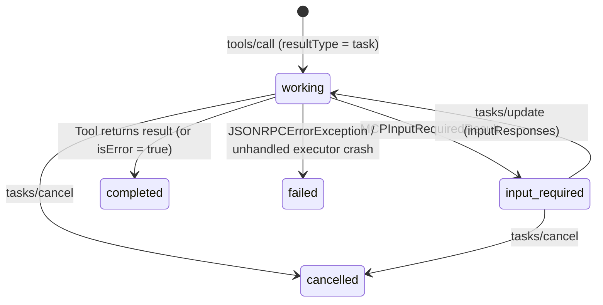

# MCP Tasks Extension (`io.modelcontextprotocol/tasks`)

The Model Context Protocol Tasks extension (`io.modelcontextprotocol/tasks`) allows MCP clients and servers to promote long-running or interactive multi-round-trip (MRTR) `tools/call` invocations into durable background tasks that clients can poll, supply interactive input to, or cancel.

---

## Enabling MCP Tasks

Enable the extension by setting `MCPConfig(tasks=True)` or passing an explicit `MCPTaskConfig` instance:

```python title="docs/examples/snippets/configuration_tasks.py"
--8<-- "docs/examples/snippets/configuration_tasks.py:example"
```

When `tasks` is enabled (or auto-enabled because `litestar-queues` `QueuePlugin` is registered on the application), `LitestarMCP` advertises `"extensions": {"io.modelcontextprotocol/tasks": {}}` inside `server/discover` and `initialize` capabilities.

### MCPTaskConfig Reference

| Field | Type | Default | Description |
| :--- | :--- | :--- | :--- |
| `store` | `Store or None` | `None` | Litestar `Store` persisting `TaskRecord` documents. When `None`, `LitestarMCP` resolves `"litestar_mcp_tasks"` from the application's `StoreRegistry` (`Litestar(stores=...)`), creating a `MemoryStore` if not pre-registered. |
| `default_ttl_ms` | `int` | `300_000` | Default time-to-live in milliseconds (5 minutes) applied to newly created task records when the client does not request a custom `ttlMs`. Must be non-negative. |
| `max_ttl_ms` | `int` | `3_600_000` | Maximum time-to-live in milliseconds (1 hour) used to clamp client-requested `ttlMs` values. Must be `>= default_ttl_ms`. |
| `poll_interval_ms` | `int` | `1_000` | Suggested polling cadence in milliseconds advertised as `pollIntervalMs` on serialized `TaskRecord` payloads. Must be positive. |
| `status_callback` | `Callable[[TaskRecord], Awaitable[None]] or None` | `None` | Optional async callback invoked on every task state transition (`working`, `input_required`, `completed`, `failed`, `cancelled`) before `LitestarMCP` publishes a `notifications/tasks` event. |
| `executor` | `MCPTaskExecutor or Literal["in_process"] or bool or None` | `None` | Pluggable task runner executing task-augmented tool calls outside the creating HTTP request. `None` auto-wires `QueueTaskExecutor` when `QueuePlugin` is present, or falls back to the built-in in-process task runner in `MCPHandlerService` and `MCPTaskStore`. Pass `"in_process"` or `False` to force in-process execution even when `QueuePlugin` is installed. |

---

## Declaring Task-Capable Tools

Individual tools declare how they participate in the Tasks extension via `@mcp_tool(task=...)` / `@mcp_tool(task_support=...)` or route `opt` keys (`mcp_task` / `mcp_task_support`):

| Declaration | Normalized Mode | Runtime Behavior on `tools/call` |
| :--- | :--- | :--- |
| `task=True` or `task_support="optional"` | `"optional"` | Promotes the tool call to a background `TaskRecord` (`resultType: "task"`) when `MCPConfig.tasks` is enabled **and** the client advertises `extensions["io.modelcontextprotocol/tasks"]`. Executes synchronously for clients that do not advertise task support. |
| `task_support="required"` | `"required"` | Requires both server-side `MCPConfig.tasks` and client-side `extensions["io.modelcontextprotocol/tasks"]`. Rejects non-task-capable clients with JSON-RPC error `-32021` (`MISSING_REQUIRED_CLIENT_CAPABILITY`). |
| `task=False` or `task_support="forbidden"` (or omitted) | `"forbidden"` | Always executes synchronously inside the `tools/call` request and returns a standard tool result. |

---

## Task State Machine

Every `TaskRecord` in `MCPTaskStore` progresses through a deterministic lifecycle:



- **`working`**: Initial status when `MCPTaskStore.create()` persists the task under `mcp-task:{task_id}` (or resumed status after all pending `inputRequests` are answered).
- **`input_required`**: Paused state entered when the tool handler returns `MCPInputRequiredResult`. The serialized task record includes `inputRequests` describing the required client actions (for example, `elicitation/create` or `sampling/createMessage`).
- **`completed`**: Terminal state when the tool handler returns a value or a tool-level error (`isError: true`). The final tool output is embedded under `record.result` with `resultType: "complete"`.
- **`failed`**: Terminal state recorded when a protocol-level `JSONRPCErrorException` or unrecoverable worker failure occurs. Carries a structured `error: {"code": ..., "message": ..., "data": ...}` payload.
- **`cancelled`**: Terminal state recorded after cooperative cancellation completes via `tasks/cancel`.

!!! note
    Terminal statuses (`completed`, `failed`, and `cancelled`) are monotonic. Once `record.is_terminal()` is `True`, subsequent transition calls are no-ops.

---

## Multi-Round Input Requests

Tools that require human confirmation, form elicitation, or client-side sampling mid-execution return an `MCPInputRequiredResult` instance and read client responses from `get_mcp_request_context()`:

### Mid-Task Pause and Resumption

When a running background task returns `MCPInputRequiredResult(input_requests={...}, request_state="...")`:

1. `MCPHandlerService` transitions the `TaskRecord` in `MCPTaskStore` to `status="input_required"`, saves `input_requests` and `request_state`, and emits a `notifications/tasks` update.
2. The client inspects `inputRequests` via `tasks/get` (or the notification) and submits responses via `tasks/update`:
   ```json
   {
     "jsonrpc": "2.0",
     "id": 12,
     "method": "tasks/update",
     "params": {
       "taskId": "8f1d4e9a2c3b4a5d9e8f7a6b5c4d3e2f",
       "inputResponses": {
         "approval": {"action": "accept"}
       }
     }
   }
   ```
3. `MCPTaskStore.update()` merges each accepted response key against the outstanding `input_requests`. If additional keys remain unanswered, the task stays in `input_required` with the remaining `inputRequests`.
4. Once all outstanding keys are satisfied, `MCPTaskStore.update()` transitions the task back to `status="working"` and resumes the tool handler with `context.input_responses` and `context.request_state` populated on `get_mcp_request_context()`.

### Pre-Task Synchronous Input

Some tools need to complete an initial elicitation or approval round *before* allocating a background `TaskRecord` or enqueuing a job. Set `task_input_before_start=True` on `@mcp_tool` (or `mcp_task_input_before_start=True` in route `opt`):

```python title="docs/examples/snippets/tool_task_input_before_start.py"
--8<-- "docs/examples/snippets/tool_task_input_before_start.py:example"
```

1. **Initial `tools/call`**: Because `context.input_responses` is `None`, `MCPHandlerService` runs the handler synchronously inside the initial HTTP request. Returning `MCPInputRequiredResult` sends `{"resultType": "input_required", "inputRequests": {...}, "requestState": "..."}` directly to the caller without creating a task record.
2. **Follow-up `tools/call`**: When the client re-invokes `tools/call` with `_meta` / `inputResponses` and `requestState` populated, `context.input_responses` is non-empty. `MCPHandlerService` creates the durable `TaskRecord`, forwards `input_responses` and `request_state` into the task execution context, and returns `{"resultType": "task", "taskId": "...", "status": "working", ...}`.

---

## Task JSON-RPC Methods & Ownership Isolation

All task methods require the caller to advertise `extensions["io.modelcontextprotocol/tasks"]` (otherwise the server returns JSON-RPC error `-32021`). Every `TaskRecord` is bound to `context.owner_id` (derived from the authenticated principal when authentication middleware is active). A caller with a different `owner_id` cannot inspect, update, or cancel another principal's task.

| Method | Parameters | Response & Behavior |
| :--- | :--- | :--- |
| `tools/call` *(task-promoted)* | `{"name": "<tool>", "arguments": {...}}` | Creates a `TaskRecord` in `MCPTaskStore`, dispatches execution to the active `MCPTaskExecutor`, and returns `{"resultType": "task", "taskId": "...", "status": "working", "createdAt": "...", "lastUpdatedAt": "...", "ttlMs": 300000, "pollIntervalMs": 1000}`. |
| `tasks/get` | `{"taskId": "<id>"}` | Returns the serialized `TaskRecord` (`taskId`, `status`, `createdAt`, `lastUpdatedAt`, `ttlMs`, `pollIntervalMs`, and optional `statusMessage` or `inputRequests`). When `status == "completed"`, `tasks/get` includes `"result": {"resultType": "complete", "content": [...], "isError": false}` (or `"isError": true`); when `status == "failed"`, `tasks/get` includes `"error": {"code": ..., "message": ...}`. Raises `INVALID_PARAMS` (`-32602`) if the task does not exist or belongs to a different `owner_id`. |
| `notifications/tasks` *(server notification)* | `subscriptions/listen` or `GET /mcp` SSE / `status_callback` | Task state and `statusMessage` transitions invoke `MCPTaskConfig.status_callback(record)` and publish `"notifications/tasks"` with `record.to_dict()` to active `2026-07-28` `subscriptions/listen` (`taskIds`) streams and owner-matched `2025-*` `GET /mcp` SSE streams. |
| `tasks/update` | `{"taskId": "<id>", "inputResponses": {...}}` | Supplies answers to pending `inputRequests` while `status == "input_required"`. When all outstanding keys are answered, transitions the task to `working`, wakes the local runner or calls `executor.resume(call)`, and returns `{}`. |
| `tasks/cancel` | `{"taskId": "<id>"}` | Requests cooperative cancellation of a non-terminal task (`working` or `input_required`) and returns `{}`. The task transitions to `status="cancelled"` once the in-process runner or distributed queue worker acknowledges cancellation. |

---

## Background Task Progress and Server Logging

When a `tools/call` invocation promotes into a background task, `MCPHandlerService` captures the caller's progress token, session identifier, and active logging threshold inside `ToolTaskCall` (persisted privately under `dispatchInternal` and omitted from public `tasks/get` responses):

| `ToolTaskCall` Field | Type | Default | Role Across In-Process & Queue Workers |
| :--- | :--- | :--- | :--- |
| `progress_token` | `str or int or None` | `None` | Stores `params._meta.progressToken` from the initial `tools/call` so promoted tasks forward `notifications/progress` across worker processes and `tasks/update` resumptions. |
| `session_id` | `str or None` | `None` | Stores the caller's `2025-11-25` (`2025-06-18` / `2025-03-26`) `Mcp-Session-Id` so background progress and log notifications route strictly to the originating session stream. |
| `log_level` | `str or None` | `None` | Stores the caller's RFC 5424 server log threshold at promotion time, refreshed from `MCPSession.log_level` whenever `tasks/update` resumes an `input_required` task. |

- **`TaskRecord.status_message` (`statusMessage`)**: Calling `await MCPTaskStore.update_status_message(task_id, status_message)` updates `record.status_message` (serialized as `"statusMessage"` in `tasks/get` and `notifications/tasks`) while the task is in `working` or `input_required`. Terminal task records (`completed`, `failed`, `cancelled`) remain immutable no-ops.
- **Post-Promotion `report_progress` & `ctx.log` Forwarding**: Inside both in-process task runners and distributed `QueueTaskExecutor` workers (`run_mcp_tool_task` / `run_task_attempt`), calling `await ctx.report_progress(progress, total=..., message=...)` updates `TaskRecord.status_message` (`statusMessage`) when `message` is supplied and emits `notifications/progress` carrying `progressToken` when `progress_token` and `session_id` are set. Calling `await ctx.log(level, data, logger=...)` emits threshold-filtered `notifications/message` events. When `MCPConfig.subscription_channels` was omitted, `QueueTaskExecutor.bind()` automatically discovers and attaches the application's `ChannelsPlugin` onto `SubscriptionManager` for cross-worker delivery.
- **Session SSE vs `subscriptions/listen` Stream Isolation**: `notifications/progress` and session-scoped `notifications/message` events deliver to the originating `2025-*` session `GET /mcp` SSE stream (`owner_id` and `session_id`). Stateless `2026-07-28` `POST /mcp` `subscriptions/listen` task streams (`taskIds`) receive `notifications/tasks` (`status` and `statusMessage`) updates and strictly exclude `notifications/progress` frames.

```python
from litestar import post

from litestar_mcp import get_mcp_request_context, mcp_tool


@post("/datasets/reindex")
@mcp_tool("reindex_dataset", task=True)
async def reindex_dataset(dataset: str) -> dict[str, str]:
    """Run a background reindex while streaming progress and server logs."""
    ctx = get_mcp_request_context()
    await ctx.log("info", {"phase": "scan", "dataset": dataset}, logger="indexer")
    await ctx.report_progress(1, total=2, message=f"Scanning {dataset}")
    await ctx.report_progress(2, total=2, message=f"Indexed {dataset}")
    return {"dataset": dataset, "status": "reindexed"}
```

---

## SEP-2663 Tool Errors vs Protocol Error Handling

In accordance with the MCP tool error contract (SEP-2663), `litestar-mcp` distinguishes between **application/tool errors** (which an LLM can read and recover from) and **protocol errors**:

| Failure Scenario | Task Lifecycle Outcome | Wire Representation |
| :--- | :--- | :--- |
| **Missing or invalid tool argument** (`_validate_tool_arguments`) | Task transitions to `status: "completed"` | `record.result` contains `{"resultType": "complete", "isError": true, "content": [{"type": "text", "text": "{\"error\":\"Invalid tool arguments\",\"errors\":[...]}"}]}` |
| **Route guard rejection or `HTTPException` inside tool handler** | Task transitions to `status: "completed"` | `record.result` contains `{"resultType": "complete", "isError": true, "content": [{"type": "text", "text": "..."}]}` |
| **Standard Python exception raised by tool handler** | Task transitions to `status: "completed"` | `record.result` contains `{"resultType": "complete", "isError": true, "content": [{"type": "text", "text": "{\"error\":\"...\"}"}]}` |
| **Explicit `JSONRPCErrorException` raised during task execution** | Task transitions to `status: "failed"` | `record.error` contains `{"code": <int>, "message": "<str>", "data": ...}` |
| **Client lacks `io.modelcontextprotocol/tasks` capability** | Rejected before task creation | Immediate JSON-RPC error `-32021` (`MISSING_REQUIRED_CLIENT_CAPABILITY`) |
| **Unknown `taskId` or mismatched `owner_id` on `tasks/get` / `update` / `cancel`** | Request rejected | Immediate JSON-RPC error `-32602` (`INVALID_PARAMS`, `"Failed to retrieve task: Task not found"`) |
