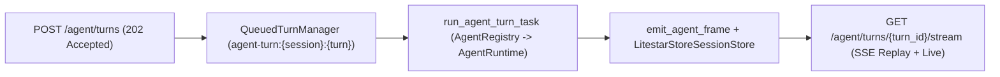

# Queued Agent Turns (`QueuedAgentChatController` & `QueuedTurnManager`)

Long-running multi-step `AgentRuntime` turns that invoke external APIs, MCP tools, or specialist `AgentGroup` handoffs can outlive standard HTTP reverse-proxy timeouts. `litestar_mcp.queues` provides `QueuedAgentChatController`, `QueuedTurnManager`, `AgentRegistry`, `PrincipalSnapshot`, `run_agent_turn_task`, and `emit_agent_frame` to offload agent turns onto `litestar-queues` while streaming sequenced `AgentStreamFrame` events over Litestar's `ChannelsPlugin`.

---

## End-to-End Wiring Example

The snippet below wires `Agent`, `AgentRuntime`, `LitestarStoreSessionStore`, `AgentRegistry`, `QueuedTurnManager`, `QueuedAgentChatController`, `ChannelsPlugin`, and `QueuePlugin` into a complete Litestar application:

```python title="docs/examples/snippets/queued_agent_turns.py"
--8<-- "docs/examples/snippets/queued_agent_turns.py"
```

---

## Queued Turn Execution Pipeline



### 1. Enqueuing a Turn (`POST /agent/turns`)

`QueuedAgentChatController` mounts at `/agent` and exposes `POST /agent/turns`:

1. **Request Payload**: Accepts a JSON object containing `user_message` (or `message`), and optional `session_id`, `turn_id`, `agent_name` (defaults to `"root"`), and `dynamic_context`.
2. **`PrincipalSnapshot` Capture**: Inspects `request.user` and `request.auth` (plus `request.state.tenant`) and builds a serializable `PrincipalSnapshot(user_id=..., tenant=..., roles=[...], scopes=[...])`.
3. **`QueuedTurnManager.enqueue_turn`**: Wraps the parameters and `PrincipalSnapshot` into a `QueuedTurn` struct (`msgspec.to_builtins`) and enqueues `run_agent_turn_task` (`litestar_mcp.agent.run_turn`) on the `"agent"` queue with idempotency key `f"agent-turn:{session_id}:{turn_id}"`.
4. **`202 Accepted` Response**: Immediately returns HTTP `202 Accepted` with the correlation identifiers and SSE stream URL:
   ```json
   {
     "session_id": "9b1deb4d3b7d4bad9bdd2b0d7b3dcb6d",
     "turn_id": "4f3c2e1a9d8b7c6e5f4a3b2c1d0e9f8a",
     "stream_url": "/agent/turns/4f3c2e1a9d8b7c6e5f4a3b2c1d0e9f8a/stream"
   }
   ```

### 2. Worker Execution (`run_agent_turn_task`)

When a `litestar-queues` worker claims `litestar_mcp.agent.run_turn` (configured with `queue="agent"`, `retries=0`, `timeout=1800`):

1. **Envelope Deserialization**: Converts the task dictionary back into a typed `QueuedTurn` struct.
2. **`AgentRegistry` Lookup**: Retrieves the target `AgentRuntime` from `get_agent_registry().get(queued_turn.agent_name)`. Worker processes register their `AgentRuntime` instances at startup via `set_agent_registry(registry)` and bind the active `ChannelsPlugin` via `set_channels_service(channels)`.
3. **`ToolContext` & Session Rehydration**: Reconstructs `ToolContext(user={"id": principal.user_id}, tenant_id=principal.tenant, session_id=..., turn_id=...)` and builds a `TurnRequest`. Because `AgentRuntime` uses `LitestarStoreSessionStore` backed by a shared Litestar `Store`, conversation history is loaded and saved under the caller's `owner_id` across worker replicas.
4. **Sequenced Frame Emission (`emit_agent_frame`)**: Iterates over `runtime.stream(turn_request)` with a monotonically increasing 1-based counter (`seq = 1, 2, ...`). For every yielded `AgentStreamFrame` (`session`, `thought`, `delta`, `tool_call`, `tool_result`, `agent_transfer`, `complete`, `error`), the worker calls:
   ```python
   await emit_agent_frame(channels, queued_turn.turn_id, frame, seq=seq)
   ```
   `emit_agent_frame` stamps `frame.seq = seq`, serializes the frame to JSON, and publishes it to `agent_turn_channel(turn_id)` (`f"litestar_mcp:agent:{turn_id}"`).

---

## Store-Backed Frame Replay & Live `ChannelsPlugin` SSE

Clients consume the turn output by connecting to `GET /agent/turns/{turn_id:str}/stream` on `QueuedAgentChatController`:

1. **History Replay + Live Wakeup**: `QueuedAgentChatController.stream_turn` opens a subscription on `agent_turn_channel(turn_id)` with `channels.start_subscription([channel_name], history=self.replay_limit)` (default `replay_limit = 1000`). If the worker already emitted frames—or even completed the turn—before the client opened the SSE stream, the buffered history frames are replayed immediately in order before transitioning seamlessly to live channel publications.
2. **Deterministic Sequence Numbers & `Last-Event-ID`**: Every `AgentStreamFrame` carries a 1-based `seq` integer. `frame.to_sse_message()` sets the SSE `id` field to `str(frame.seq)` and `event` to `frame.event_type`:
   ```text
   id: 1
   event: session
   data: {"event_type":"session","turn_id":"4f3c...","seq":1,"payload":{"session_id":"9b1d..."}}

   id: 2
   event: delta
   data: {"event_type":"delta","turn_id":"4f3c...","seq":2,"agent_name":"root","text":"Background analysis completed."}

   id: 3
   event: complete
   data: {"event_type":"complete","turn_id":"4f3c...","seq":3,"agent_name":"root","payload":{"output":"Background analysis completed."}}
   ```
3. **Deduplication & Keep-Alive Pings**: `stream_turn` tracks `last_seq` and drops any duplicate frame where `frame.seq <= last_seq`. While waiting for the next model or tool frame, if `self.ping_interval` (`15.0` seconds) elapses without an event, the generator yields an SSE `event: ping` keep-alive frame (`anyio.move_on_after(self.ping_interval)`).
4. **Automatic Stream Termination**: As soon as a frame with `frame.event_type in TERMINAL_EVENTS` (`"complete"` or `"error"`) is yielded, `stream_turn` closes the subscription and terminates the SSE response cleanly under `StreamCleanupMiddleware`.

---

## Core Components Reference

| Symbol | Module | Role |
| :--- | :--- | :--- |
| `QueuedAgentChatController` | `litestar_mcp.queues` | Litestar `Controller` mounting `POST /agent/turns` (`202 Accepted`) and `GET /agent/turns/{turn_id:str}/stream` (SSE). Configurable `path = "/agent"`, `replay_limit = 1000`, and `ping_interval = 15.0`. |
| `QueuedTurnManager` | `litestar_mcp.queues` | Service injected as `turn_manager` that serializes `QueuedTurn` envelopes and enqueues `run_agent_turn_task` on `litestar-queues` under `agent-turn:{session_id}:{turn_id}`. |
| `QueuedTurn` | `litestar_mcp.queues` | `msgspec.Struct` dispatch envelope holding `session_id`, `turn_id`, `user_message`, `agent_name`, `dynamic_context`, and `principal` (`PrincipalSnapshot`). |
| `PrincipalSnapshot` | `litestar_mcp.queues` | `msgspec.Struct` capturing `user_id`, `tenant`, `roles`, and `scopes` from the originating HTTP request for worker `ToolContext` reconstruction. |
| `AgentRegistry` | `litestar_mcp.queues` | Name-to-`AgentRuntime` registry queried by `run_agent_turn_task` inside worker processes (`set_agent_registry` / `get_agent_registry`). |
| `run_agent_turn_task` | `litestar_mcp.queues` | `@task("litestar_mcp.agent.run_turn", queue="agent", retries=0, timeout=1800)` executing `runtime.stream(turn_request)` and publishing frames via `emit_agent_frame`. |
| `emit_agent_frame` | `litestar_mcp.queues` | Assigns `seq` onto an `AgentStreamFrame`, serializes to JSON, and publishes to `agent_turn_channel(turn_id)` (`litestar_mcp:agent:{turn_id}`). |
