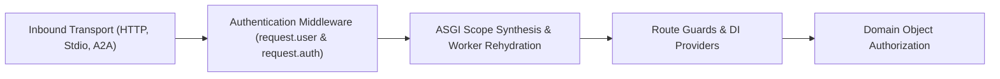

# Security Model & Trust Boundaries

`litestar-mcp` treats the Model Context Protocol (MCP), Agent-to-Agent (A2A 1.0) bindings, and background agent/task workers as transports into your Litestar application rather than separate security silos. Every tool, resource, prompt, and skill executes through Litestar's internal ASGI pipeline, inheriting your application's authentication middleware, route guards, and dependency injection graph.

---

## End-to-End Security Pipeline

Authentication and authorization are separated into two explicit layers:

1. **Transport Authentication Boundary**: Litestar middleware (or `MCPStdioContext` on local stdio) validates credentials at the edge and populates `request.user`, `request.auth`, and `scope["litestar_security"]`.
2. **Handler & Domain Authorization**: Internal ASGI synthesis (`execute_tool`, `execute_prompt`, `execute_handler`) and `QueueTaskExecutor` worker rehydration forward that validated identity into route `guards`, `Provide` / `FromDishka[T]` dependencies, and domain services that verify object ownership.

---

## Trust Boundaries by Transport and Execution Mode

The source of caller identity depends on how the request enters your application and whether execution stays in-process or crosses into a `litestar-queues` worker:

| Transport / Execution Mode | Entry Point | Identity Source | Scope & Context Populated | Isolation Boundary |
| :--- | :--- | :--- | :--- | :--- |
| **Streamable HTTP** (`2026-07-28`, `2025-06-18`, `2025-03-26`) | `POST /mcp`, `DELETE /mcp` | Litestar `AbstractAuthenticationMiddleware`, `OAuth2PasswordBearerAuth`, `litestar-security` `SecurityPlugin`, or IAP assertion validator | `request.user`, `request.auth`, `scope["litestar_security"]`, forwarded HTTP headers | Per-request ASGI scope; `Origin` header validated against `MCPConfig.allowed_origins` |
| **In-Process Stdio** | `litestar mcp stdio`, `run_stdio`, `MCP.run(transport="stdio")` | `MCPStdioContext` or CLI `--header` / `--bearer-env` / `--bearer-cmd` forwarded into internal ASGI scope | `scope["user"]`, `scope["auth"]`, `scope["litestar_mcp.owner_id"]`, `scope["session"]`, `scope["state"]` | Local OS process boundary; anonymous stdio receives `owner_id=None` (never a shared `"stdio"` owner) |
| **HTTP-to-Stdio Bridge** | `litestar mcp bridge`, `run_stdio_streamable_http_bridge` | Bearer token (`--bearer-env`, `--bearer-cmd`) or static headers (`--header`) sent over HTTPS to remote `/mcp` | Validated on the remote Litestar server by its HTTP authentication middleware | Untrusted client-side forwarder; all authentication and authorization happen on the target HTTP server |
| **Distributed MCP Tasks** (`litestar-queues`) | `QueueTaskExecutor` (`litestar_mcp.mcp.run_tool_task`) | `extract_principal_snapshot` at enqueue time -> `rehydrate_security_scope` or `principal_loader` in worker | `scope["user"]` (`Principal` / user struct), `scope["auth"]`, `scope["litestar_security"]` (`SecurityContext`), Dishka `Scope.REQUEST` | `TaskRecord.owner_id` locks `tasks/get`, `tasks/update`, and `tasks/cancel` to the creating principal |
| **Queued Agent Turns** (`litestar-queues`) | `QueuedAgentChatController`, `QueuedTurnManager` (`litestar_mcp.agent.run_turn`) | `PrincipalSnapshot` (`user_id`, `tenant`, `roles`, `scopes`) serialized in `QueuedTurn` | `ToolContext(user=..., tenant_id=..., session_id=..., turn_id=...)` | `SessionStore` owner scoping and turn-scoped stream replay |
| **A2A 1.0 Endpoints** | `POST /a2a` (JSON-RPC) & `/a2a/message:send` (`HTTP+JSON` REST) | Litestar authentication middleware + `A2AConfig.context_builder(request, context)` | `ServerCallContext.user`, `ServerCallContext.tenant`, `ServerCallContext.state` | Multi-tenant path (`/{tenant:str}`) or `X-A2A-Tenant` header validated inside `context_builder` and owner-checked `TaskStore` |

---

## Transport Authentication vs Domain Object Authorization

Authenticating a caller and isolating their protocol-level task or session records does not prove that the caller is permitted to read or mutate the domain entity referenced in tool arguments.

| Security Layer | Question Answered | Enforced By | Example |
| :--- | :--- | :--- | :--- |
| **Transport Authentication** | *Who is the caller making this MCP, stdio, or A2A request?* | Litestar authentication middleware, `litestar-security`, `MCPStdioContext` | Verifying a Bearer JWT or `x-goog-iap-jwt-assertion` header and binding `request.user` |
| **Capability / Route Authorization** | *Is this principal allowed to invoke this tool, prompt, or controller?* | Litestar `Guard` functions, `MCPConfig.guards`, `MCPConfig.auth`, `MCPConfig.route_opt` | Checking that `request.auth` includes the `report:read` scope or `admin` role |
| **Protocol Task & Session Isolation** | *Did the caller create the `taskId` or `session_id` they are polling or cancelling?* | `MCPTaskStore` (`TaskRecord.owner_id`), `SessionStore` (`owner_id`), `a2a-sdk` task store | Rejecting `tasks/get` when `record.owner_id != current_owner_id` |
| **Domain Object Authorization** | *Does the authenticated principal own or have access to the requested `workspace_id`, `note_id`, or file handle?* | Application `Provide` / `FromDishka` dependencies and repository queries (`WHERE owner_sub = :sub`) | Verifying `request.user.sub == workspace.owner_id` before exporting a workspace |

!!! warning "Never trust client-supplied identity fields in tool arguments"
    Treat tool arguments such as `user_id`, `tenant_id`, `workspace_id`, or `file_path` as untrusted selectors. Always compare them against server-validated identity on `request.user`, `request.auth`, `scope["litestar_security"]`, or `ToolContext`.

---

## Security and Operations Guides

  

    

      <h3>Authentication Middleware, JWT &amp; Google IAP</h3>
      
Configure Litestar <code>AbstractAuthenticationMiddleware</code>, <code>OAuth2PasswordBearerAuth</code>, Google Cloud IAP signed assertions, and <code>MCPStdioContext</code>.

    

    <a href="authentication/">Authentication Guide &rarr;</a>
  

  

    

      <h3>First-Party litestar-security Integration</h3>
      
Configure optional mechanism policies with <code>MCPConfig(auth=required(...))</code>, publish RFC 9728 protected-resource metadata, and rehydrate <code>SecurityContext</code> in queue workers.

    

    <a href="litestar-security/">litestar-security Guide &rarr;</a>
  

  

    

      <h3>Authorization, Guards, Scopes &amp; Input Safety</h3>
      
Enforce route guards, understand discovery-only tool scopes, protect multi-round <code>requestState</code> with AEAD/HMAC, and validate remote file/path arguments.

    

    <a href="authorization-and-scopes/">Authorization &amp; Scopes &rarr;</a>
  

  

    

      <h3>OpenTelemetry Tracing &amp; Tool Callbacks</h3>
      
Emit GenAI semantic convention spans with <code>TelemetryConfig</code> and <code>SpanManager</code>, and wire <code>before_tool_call</code> / <code>after_tool_call</code> audit hooks.

    

    <a href="observability/">Observability Guide &rarr;</a>
  

