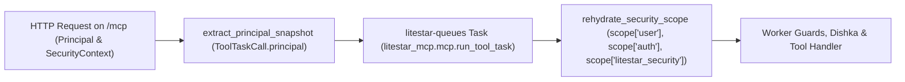

# First-Party litestar-security Integration

`litestar-security` is an **optional** integration (`litestar-mcp` works standalone or with standard Litestar authentication middleware and guards). Applications that standardize on `litestar-security` (`>=0.7.0`) for multi-mechanism authentication (`APIKeyConfig`, `GoogleIAPConfig`, cookie sessions), role/permission/scope evaluation, and RFC 9728 OAuth 2.0 Protected Resource Metadata integrate with `litestar-mcp` without adapter boilerplate:

1. **Zero-Boilerplate Default Enforcement (`SecurityPlugin`)**: When `SecurityPlugin(security_config)` is registered with any default-participating mechanism, `SecurityPlugin` automatically compiles routes with no explicit policy—including `/mcp`—to an implicit `required()` policy, so `LitestarMCP()` works out of the box with zero `MCPConfig` auth configuration.
2. **Optional Mechanism Narrowing (`MCPConfig(auth=...)`)**: Both `MCPConfig(auth=...)` and `A2AConfig(auth=...)` are optional promoted parameters (`router_opt["auth"] = config.auth`) used when narrowing `/mcp` or `/a2a` to specific authentication mechanisms (for example, `MCPConfig(auth=required("api-key"))` when browser cookie sessions are also configured on the app). `MCPConfig(route_opt=...)` remains available for arbitrary extra Litestar route `opt` keys.
3. **Native `Principal` & `SecurityContext` Propagation**: Internal ASGI tool and prompt dispatch (`execute_tool`, `execute_prompt`) preserves `connection.user` (`Principal`), `connection.auth` (`SecurityContext`), and `scope["litestar_security"]`.
4. **Zero-Config Worker Rehydration (`QueueTaskExecutor`)**: When task-augmented `tools/call` executions run asynchronously on `litestar-queues` workers, `litestar-mcp` automatically snapshots and rehydrates `Principal`, `AuthorizationSnapshot`, `CredentialRestrictions`, and `SecurityContext` into the worker's synthesized request scope.

---

## Installation

Install `litestar-mcp` alongside `litestar-security` (and include the `queues` extra if you run distributed MCP Tasks on `litestar-queues`):

=== "uv"

    ```bash
    uv add litestar-mcp litestar-security
    ```

=== "pip"

    ```bash
    pip install litestar-mcp litestar-security
    ```

=== "pdm"

    ```bash
    pdm add litestar-mcp litestar-security
    ```

=== "poetry"

    ```bash
    poetry add litestar-mcp litestar-security
    ```

---

## Optional Mechanism Policies with MCPConfig

Both `litestar-security` and `MCPConfig(auth=...)` are optional. When `SecurityPlugin(security_config)` is installed on your `Litestar` application, routes without an explicit policy (including `/mcp`) automatically default to `required()` across all default-participating mechanisms.

When your application configures multiple mechanisms (such as cookie sessions for browser routes and API keys for machine clients) and you want to restrict `/mcp` to specific authentication mechanisms, pass `auth=required("api-key")` directly to `MCPConfig`:

```python title="docs/examples/snippets/litestar_security_mcp.py"
--8<-- "docs/examples/snippets/litestar_security_mcp.py:example"
```

`LitestarMCP` sets `router_opt["auth"] = config.auth` on the `/mcp` router (`A2AConfig(auth=...)` applies the same contract to `/a2a`). Use `MCPConfig(route_opt=...)` whenever you need to attach additional custom Litestar route `opt` keys alongside `auth`.

---

## Reading Principal and SecurityContext in Tools and Guards

When `litestar-security` authenticates a request on `/mcp`, it populates three scope keys that remain available inside every MCP tool handler, dependency provider (`Provide` or Dishka `FromDishka[T]`), and route `Guard`:

| Scope / Connection Attribute | `litestar-security` Type | Key Attributes | Description |
| :--- | :--- | :--- | :--- |
| `request.user` / `connection.user` | `Principal` | `user`, `account_id`, `subject`, `mechanisms`, `restrictions`, `attributes` | Wraps your domain user entity (`principal.user`) with canonical `account_id`, `subject`, and active mechanism names. |
| `request.auth` / `connection.auth` | `SecurityContext` | `principal`, `authorization`, `restrictions` | Complete per-request security evaluation context. |
| `request.scope["litestar_security"]` | `SecurityContext` | `principal`, `authorization`, `restrictions` | Explicit ASGI scope key read by `litestar-security` guards, evaluators, and `litestar-mcp` task snapshotting. |
| `security_context.authorization` | `AuthorizationSnapshot` | `roles`, `permissions`, `scopes`, `attributes`, `tenant_roles` | Immutable `frozenset` collections of effective roles, permissions, OAuth scopes, and per-tenant role mappings (`Mapping[str, frozenset[str]]`). |
| `security_context.restrictions` | `tuple[CredentialRestrictions, ...]` | `scopes`, `tenant_ids`, `roles` | Optional narrowing restrictions attached to scoped API keys or delegated tokens. |

---

## RFC 9728 Protected Resource Metadata and WWW-Authenticate Challenges

MCP clients that support OAuth 2.1 / RFC 9728 discover your authorization server by inspecting the `WWW-Authenticate: Bearer resource_metadata="..."` response header returned when an unauthenticated request hits `/mcp`, then fetching `GET /.well-known/oauth-protected-resource`.

In `litestar-security`, configure bearer token acceptance and the RFC 9728 metadata document on `SecurityConfig`:

1. **Configure a Bearer-Capable Mechanism on `SecurityConfig`**: Pass `APIKeyConfig(..., accept_authorization_bearer=True)` (or another bearer-enabled mechanism config) on `SecurityConfig`. `litestar-security` emits the `WWW-Authenticate: Bearer resource_metadata=...` header on authentication evaluator failures (`401 Unauthorized`), never on post-authentication guard failures (`403 Forbidden`).
2. **Publish `ProtectedResourceConfig` on `SecurityConfig.protected_resource`**: `SecurityPlugin` mounts `/.well-known/oauth-protected-resource` advertising your resource identifier, `authorization_servers`, and `scopes_supported`.

```python
from litestar import Litestar, Request, get
from litestar_security import (
    APIKeyConfig,
    ProtectedResourceConfig,
    SecurityConfig,
    SecurityPlugin,
    required,
)

from litestar_mcp import LitestarMCP, MCPConfig


@get("/notes", mcp_tool="list_notes")
async def list_notes(request: Request) -> dict[str, object]:
    """List notes for the authenticated principal."""
    return {
        "account_id": request.user.account_id,
        "scopes": sorted(request.auth.authorization.scopes),
    }


security_config = SecurityConfig(
    api_key=APIKeyConfig(
        store=api_key_store,
        accept_authorization_bearer=True,
    ),
    protected_resource=ProtectedResourceConfig(
        resource="https://api.example.com/mcp",
        authorization_servers=("https://auth.example.com",),
        scopes_supported=("notes:read", "notes:write"),
    ),
)

mcp_config = MCPConfig(
    auth=required("api-key"),
)

app = Litestar(
    route_handlers=[list_notes],
    plugins=[
        SecurityPlugin(security_config),
        LitestarMCP(mcp_config),
    ],
)
```

!!! important "Evaluator Failures (401) vs Guard Failures (403)"
    If a request arrives without a valid token, `litestar-security`'s mechanism evaluator rejects `/mcp` at the HTTP boundary with `401 Unauthorized` and attaches `WWW-Authenticate: Bearer resource_metadata="https://api.example.com/.well-known/oauth-protected-resource"`, prompting the MCP client to initiate the OAuth flow. Once authenticated, if a route guard rejects a specific `tools/call` due to missing permissions, the failure occurs inside the tool dispatch and is reported as an MCP tool error (`isError: true`).

---

## Automatic Worker Rehydration in QueueTaskExecutor

When a client invokes a task-augmented tool (`params.task` under `io.modelcontextprotocol/tasks`) and `QueueTaskExecutor` dispatches the execution attempt to a separate `litestar-queues` worker process, the live HTTP connection is no longer present.

`litestar-mcp` bridges `litestar-security` across the queue boundary automatically through `extract_principal_snapshot` and `rehydrate_security_scope` in `litestar_mcp.mcp.tasks`:



### What Is Captured at Enqueue Time

When `MCPHandlerService` creates the `ToolTaskCall` envelope, `extract_principal_snapshot` inspects `request.user`, `request.auth`, and `request.scope.get("litestar_security")` and serializes:

- **Inner Domain User**: JSON-safe fields of `principal.user` (including `id`, `sub`, `user_id`, `account_id`, `username`, `email`, `roles`, `scopes`, `permissions`, `tenant`, `tenant_id`) plus a `__user_type__` tag (`"<module>:<QualName>"`) when the inner user is a `msgspec.Struct` or `@dataclass`.
- **`Principal` Metadata (`__litestar_security__.principal`)**: `account_id`, `subject`, `mechanisms` tuple, `attributes` mapping, and principal-level `restrictions`.
- **`AuthorizationSnapshot` (`__litestar_security__.authorization`)**: `roles`, `permissions`, `scopes`, `attributes`, and `tenant_roles`.
- **Context `CredentialRestrictions` (`__litestar_security__.restrictions`)**: `scopes`, `tenant_ids`, and `roles` restriction sets.

### What Is Rehydrated in the Worker

When `run_mcp_tool_task` executes on a `litestar-queues` worker:

1. `rehydrate_security_scope` reconstructs the inner user struct via `msgspec.convert` (when `__user_type__` resolves to a loaded `msgspec.Struct` or `@dataclass`) or wraps the user fields in `PrincipalProxy` (supporting both `user.id` attribute access and `user["id"]` key lookup).
2. It imports `Principal`, `AuthorizationSnapshot`, `CredentialRestrictions`, and `SecurityContext` from `litestar_security.context` (falling back to structurally identical frozen dataclasses if `litestar_security` is not imported) and reconstructs the immutable security graph.
3. It populates `scope["user"] = principal_obj`, `scope["auth"] = security_ctx`, and `scope["litestar_security"] = security_ctx` on the worker's synthetic HTTP scope before Dishka `Scope.REQUEST` dependencies, Litestar `Provide` dependencies, and route `guards` execute.

### Custom Fail-Closed Principal Rehydration

If your worker must re-fetch the live account record from a database on every attempt (for example, to check whether an account was suspended between enqueue time and worker execution), pass an async `principal_loader` callback to `QueueTaskExecutor`:

```python
from litestar_mcp import LitestarMCP, MCPConfig, MCPTaskConfig
from litestar_mcp.queues import QueueTaskExecutor


async def load_active_principal(owner_id: str) -> dict[str, object]:
    """Load the current user record from the database or raise if revoked."""
    raw_user_id = owner_id.removeprefix("user:")
    return {"id": raw_user_id, "sub": raw_user_id, "is_active": True}


config = MCPConfig(
    tasks=MCPTaskConfig(
        executor=QueueTaskExecutor(principal_loader=load_active_principal),
    ),
)
plugin = LitestarMCP(config)
```

When `principal_loader` returns a non-`None` user object, that object takes precedence as `scope["user"]` while `scope["litestar_security"]` continues to provide the rehydrated `SecurityContext` snapshot. See [Distributed Task Queues](../queues/distributed-task-queues.md) for full `QueueTaskExecutor` configuration details.
